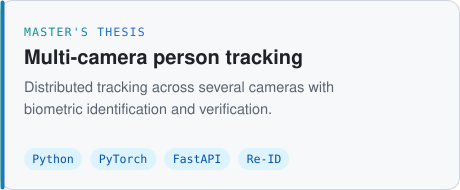
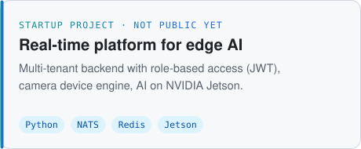
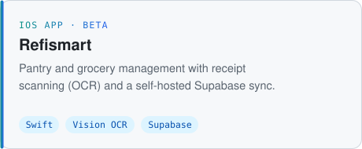
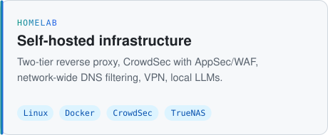
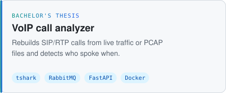
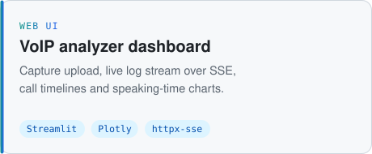
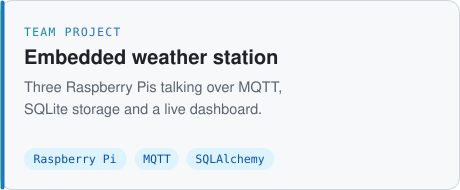

<picture>
  <source media="(prefers-color-scheme: dark)" srcset="assets/banner-dark.svg">
  
</picture>

  
  
  
  

I'm a Computer Science Master's student at Johannes Kepler University Linz, specializing in Networks & Security. I expect to graduate in summer 2027 with the Dipl.-Ing. degree. Before computer science I trained as a design engineer in tool making and worked as a product developer at Julius Blum, where I was responsible for the drawer systems LEGRABOX and MOVENTO.

I like systems that run on real networks and real hardware: backends that move data in real time, devices at the edge, and the infrastructure underneath that has to stay secure.

### What I'm building

<picture>
  <source media="(prefers-color-scheme: dark)" srcset="assets/card-thesis-dark.svg">
  
</picture>
<picture>
  <source media="(prefers-color-scheme: dark)" srcset="assets/card-edge-dark.svg">
  
</picture>
<a href="https://refismart.app"><picture>
  <source media="(prefers-color-scheme: dark)" srcset="assets/card-refismart-dark.svg">
  
</picture></a>
<picture>
  <source media="(prefers-color-scheme: dark)" srcset="assets/card-homelab-dark.svg">
  
</picture>

Most of this lives in private repositories on my own Gitea server. I'm happy to walk through the code in an interview.

### Public projects

<a href="https://github.com/lightningstorch/Bachelor_VoIP_Softphone"><picture>
  <source media="(prefers-color-scheme: dark)" srcset="assets/card-voip-dark.svg">
  
</picture></a>
<a href="https://github.com/lightningstorch/Bachelor_VoIP_UI"><picture>
  <source media="(prefers-color-scheme: dark)" srcset="assets/card-voip-ui-dark.svg">
  
</picture></a>
<a href="https://github.com/lightningstorch/Embedded_Wetter_Station"><picture>
  <source media="(prefers-color-scheme: dark)" srcset="assets/card-weather-dark.svg">
  
</picture></a>

### Tech I work with

<picture>
  <source media="(prefers-color-scheme: dark)" srcset="https://skillicons.dev/icons?i=python%2Cswift%2Ckotlin%2Cjava%2Cfastapi%2Cpostgres%2Csqlite%2Credis%2Crabbitmq%2Csupabase%2Cdocker%2Clinux%2Cgit%2Craspberrypi%2Cpytorch%2Copencv&perline=8&theme=dark">
  
</picture>

Also: NATS, MQTT, Wireshark/tshark, CrowdSec, reverse proxies, DNS filtering, VPN, TrueNAS, NVIDIA Jetson, ROS 2.

I'm looking for roles in software development, IT security and networking. The fastest way to reach me is [LinkedIn](https://www.linkedin.com/in/manuel-spiss).
