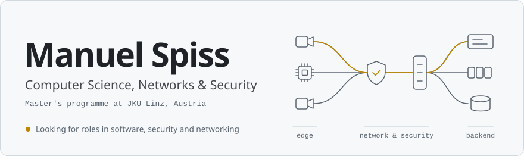
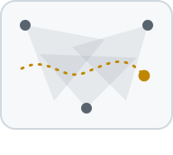
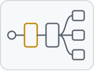
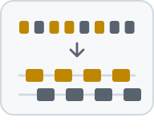
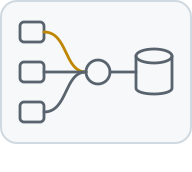
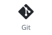
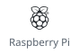

<picture>
  <source media="(prefers-color-scheme: dark)" srcset="assets/header-dark.svg">
  
</picture>

I study Computer Science at Johannes Kepler University Linz, in the Master's programme with a focus on networks and security. I expect to graduate in summer 2027 with the Dipl.-Ing. degree. Before computer science I trained as a design engineer in tool making and worked as a product developer at Julius Blum, where I was responsible for the drawer systems LEGRABOX and MOVENTO.

I mostly work on backend services, on software for edge devices, and on the servers and networks underneath.

### Working on now

<picture><source media="(prefers-color-scheme: dark)" srcset="assets/fig-thesis-dark.svg"></picture>**Multi-camera person tracking** 
Distributed tracking across several cameras with biometric identification and verification. 
Master's thesis · Python, PyTorch, FastAPI, Re-ID 

<picture><source media="(prefers-color-scheme: dark)" srcset="assets/fig-edge-dark.svg"></picture>**Real-time platform for edge AI** 
Multi-tenant backend with role-based access (JWT), a camera device engine, and AI on NVIDIA Jetson. 
Startup project, not public yet · Python, NATS, Redis, Jetson 

<picture><source media="(prefers-color-scheme: dark)" srcset="assets/fig-refismart-dark.svg"></picture>**[Refismart](https://refismart.app)** 
Pantry and grocery management with receipt scanning (OCR) and sync through a self-hosted Supabase. 
iOS app, in beta · Swift, Vision OCR, Supabase 

<picture><source media="(prefers-color-scheme: dark)" srcset="assets/fig-homelab-dark.svg"></picture>**Self-hosted infrastructure** 
Two-tier reverse proxy, CrowdSec with AppSec/WAF, network-wide DNS filtering, VPN and local LLMs. 
Homelab · Linux, Docker, CrowdSec, TrueNAS 

Most of this lives in private repositories on my own Gitea server. I'm happy to walk through the code in an interview.

### Public code

<picture><source media="(prefers-color-scheme: dark)" srcset="assets/fig-voip-dark.svg"></picture>**[VoIP call analyzer](https://github.com/lightningstorch/Bachelor_VoIP_Softphone)** 
Rebuilds SIP/RTP calls from live traffic or PCAP files and detects who spoke when. 
Bachelor's thesis · tshark, RabbitMQ, FastAPI, Docker 

<picture><source media="(prefers-color-scheme: dark)" srcset="assets/fig-voip-ui-dark.svg"></picture>**[VoIP analyzer dashboard](https://github.com/lightningstorch/Bachelor_VoIP_UI)** 
Capture upload, live log stream over SSE, call timelines and speaking-time charts. 
Web UI for the analyzer · Streamlit, Plotly, httpx-sse 

<picture><source media="(prefers-color-scheme: dark)" srcset="assets/fig-weather-dark.svg"></picture>**[Embedded weather station](https://github.com/lightningstorch/Embedded_Wetter_Station)** 
Three Raspberry Pis talking over MQTT, with SQLite storage and a live dashboard. 
Team project · Raspberry Pi, MQTT, SQLAlchemy 

### Tools

<table>
  <tr><td><b>Languages</b></td><td><picture><source media="(prefers-color-scheme: dark)" srcset="assets/tool-python-dark.svg"></picture><picture><source media="(prefers-color-scheme: dark)" srcset="assets/tool-swift-dark.svg"></picture><picture><source media="(prefers-color-scheme: dark)" srcset="assets/tool-kotlin-dark.svg"></picture><picture><source media="(prefers-color-scheme: dark)" srcset="assets/tool-java-dark.svg"></picture></td></tr>
  <tr><td><b>Backend and messaging</b></td><td><picture><source media="(prefers-color-scheme: dark)" srcset="assets/tool-fastapi-dark.svg"></picture><picture><source media="(prefers-color-scheme: dark)" srcset="assets/tool-rabbitmq-dark.svg"></picture><picture><source media="(prefers-color-scheme: dark)" srcset="assets/tool-nats-dark.svg"></picture><picture><source media="(prefers-color-scheme: dark)" srcset="assets/tool-mqtt-dark.svg"></picture><picture><source media="(prefers-color-scheme: dark)" srcset="assets/tool-redis-dark.svg"></picture></td></tr>
  <tr><td><b>Data and dashboards</b></td><td><picture><source media="(prefers-color-scheme: dark)" srcset="assets/tool-postgresql-dark.svg"></picture><picture><source media="(prefers-color-scheme: dark)" srcset="assets/tool-sqlite-dark.svg"></picture><picture><source media="(prefers-color-scheme: dark)" srcset="assets/tool-sqlalchemy-dark.svg"></picture><picture><source media="(prefers-color-scheme: dark)" srcset="assets/tool-supabase-dark.svg"></picture><picture><source media="(prefers-color-scheme: dark)" srcset="assets/tool-streamlit-dark.svg"></picture><picture><source media="(prefers-color-scheme: dark)" srcset="assets/tool-plotly-dark.svg"></picture></td></tr>
  <tr><td><b>Infrastructure</b></td><td><picture><source media="(prefers-color-scheme: dark)" srcset="assets/tool-linux-dark.svg"></picture><picture><source media="(prefers-color-scheme: dark)" srcset="assets/tool-docker-dark.svg"></picture><picture><source media="(prefers-color-scheme: dark)" srcset="assets/tool-git-dark.svg"></picture><picture><source media="(prefers-color-scheme: dark)" srcset="assets/tool-truenas-dark.svg"></picture><picture><source media="(prefers-color-scheme: dark)" srcset="assets/tool-raspberrypi-dark.svg"></picture><picture><source media="(prefers-color-scheme: dark)" srcset="assets/tool-reverse-proxy-dark.svg"></picture></td></tr>
  <tr><td><b>Security and networks</b></td><td><picture><source media="(prefers-color-scheme: dark)" srcset="assets/tool-crowdsec-dark.svg"></picture><picture><source media="(prefers-color-scheme: dark)" srcset="assets/tool-wireshark-dark.svg"></picture><picture><source media="(prefers-color-scheme: dark)" srcset="assets/tool-dns-filtering-dark.svg"></picture><picture><source media="(prefers-color-scheme: dark)" srcset="assets/tool-vpn-dark.svg"></picture></td></tr>
  <tr><td><b>AI and vision</b></td><td><picture><source media="(prefers-color-scheme: dark)" srcset="assets/tool-pytorch-dark.svg"></picture><picture><source media="(prefers-color-scheme: dark)" srcset="assets/tool-opencv-dark.svg"></picture><picture><source media="(prefers-color-scheme: dark)" srcset="assets/tool-jetson-dark.svg"></picture><picture><source media="(prefers-color-scheme: dark)" srcset="assets/tool-ros2-dark.svg"></picture></td></tr>
</table>

I'm looking for roles in software development, IT security and networking. The fastest way to reach me is [LinkedIn](https://www.linkedin.com/in/manuel-spiss).
